<!-- profilescape:start -->

<picture>
  <source media="(prefers-color-scheme: dark)" srcset="https://raw.githubusercontent.com/shaikreshma21082000/shaikreshma21082000/profilescape-output/hero-dark.svg" />
  
</picture>

<a href="https://github.com/shaikreshma21082000">
<picture>
  <source media="(prefers-color-scheme: dark)" srcset="https://raw.githubusercontent.com/shaikreshma21082000/shaikreshma21082000/profilescape-output/social-github-dark.svg" />
  
</picture>
</a>
<a href="https://www.linkedin.com/in/shaik-reshma-21082000">
<picture>
  <source media="(prefers-color-scheme: dark)" srcset="https://raw.githubusercontent.com/shaikreshma21082000/shaikreshma21082000/profilescape-output/social-linkedin-dark.svg" />
  
</picture>
</a>
<a href="https://medium.com/@shaikreshma21082000">
<picture>
  <source media="(prefers-color-scheme: dark)" srcset="https://raw.githubusercontent.com/shaikreshma21082000/shaikreshma21082000/profilescape-output/social-medium-dark.svg" />
  
</picture>
</a>

<picture>
  <source media="(prefers-color-scheme: dark)" srcset="https://raw.githubusercontent.com/shaikreshma21082000/shaikreshma21082000/profilescape-output/stack-dark.svg" />
  
</picture>

<picture>
  <source media="(prefers-color-scheme: dark)" srcset="https://raw.githubusercontent.com/shaikreshma21082000/shaikreshma21082000/profilescape-output/stats-dark.svg" />
  
</picture>

<picture>
  <source media="(prefers-color-scheme: dark)" srcset="https://raw.githubusercontent.com/shaikreshma21082000/shaikreshma21082000/profilescape-output/languages-dark.svg" />
  
</picture>

<!-- profilescape:end -->

## About me

Software Engineer II at Allstate India (Bengaluru) with 4+ years of experience building high-throughput enterprise applications in Java 8/17, Spring Boot, Hibernate/JPA and Angular. I work on event-driven services (Kafka, TIBCO EMS), containerised deployments on Docker, Kubernetes and Azure, and developer tooling that removes repetitive work. Outside work I build AI agents around local LLMs and Spring AI, and I write about what I learn.

## Impact highlights

| Result | How |
| --- | --- |
| **24 h → 3 h** enterprise batch processing | Adopted Java Virtual Threads (Project Loom) |
| **Hours → 15 min** pipeline processing | Multithreading for a data pipeline |
| **50%+ less** manual migration effort | GitHub Copilot extensions that automate legacy Spring Boot and Gradle migrations |
| **100% data integrity, zero event loss** | Kafka to TIBCO EMS middleware with a reconciliation mechanism |
| **2 promotions in 4 years** | Associate Consultant → Software Engineer I → Software Engineer II |

## Featured work

**AI-powered Gmail automation agent** · `Java 17` `Spring Boot` `Ollama` `Llama2` `Vicuna` `Gmail API` `Google Calendar API` `OAuth2`
A privacy-first agent that runs on locally hosted LLMs, checks unread Gmail every 30 minutes, sorts out promotional mail, auto-replies to HR emails and creates Google Calendar events from interview invitations. Built as a multi-module Gradle project.

**[multi-model](https://github.com/shaikreshma21082000/multi-model)** · `Spring Boot 4` `Spring AI` `Ollama` `OpenAI`
A Spring Boot service that talks to a hosted OpenAI model and a local Ollama model side by side through separate Spring AI chat clients.

**In progress:** a RAG chatbot for enterprise policy questions and an agent that automates ticket booking.

## Experience

| Role | Period |
| --- | --- |
| Software Engineer II, Allstate India | Oct 2025 – present |
| Software Engineer I, Allstate India | Apr 2024 – Sep 2025 |
| Associate Consultant, Allstate India | Jun 2022 – Mar 2024 |

Day to day: backend architecture for multi-state insurance data services, REST APIs, Kafka pipelines, CI/CD with Jenkins and Gradle, SonarQube quality gates, JUnit and Mockito test suites, and production support with Datadog, Splunk and Iris.

## Latest articles

I have published 8 technical articles on Medium covering Java 17 features, SOLID principles, design patterns and GenAI application development.

<!-- medium:start -->
- [Read my articles on Medium](https://medium.com/@shaikreshma21082000)
<!-- medium:end -->

## Education and recognition

- B.Tech, Jawaharlal Nehru Technological University Hyderabad (2017 – 2021)
- Recognised by the Telangana State Innovation Cell (TSIC) at Telangana Innovation Yatra for outstanding performance
- Certificate of merit for academic excellence

## Let's connect

[LinkedIn](https://www.linkedin.com/in/shaik-reshma-21082000/) · [Medium](https://medium.com/@shaikreshma21082000)
